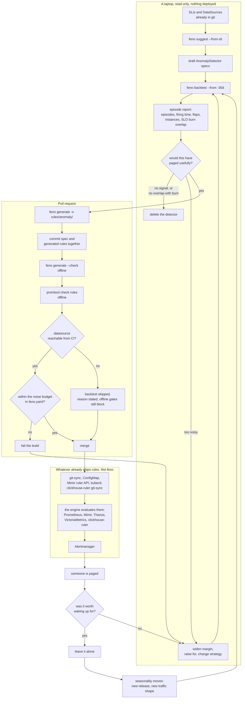

# feno

Status: research / draft spec
Date: 2026-10-10
Binary: `feno`

Anomaly detector specifications compiled into the alert rules a stack already
evaluates, and replayed over real history before they ship. The specification
is OpenSLO's, extended rather than replaced.

This file carries the design and the research behind it as eleven parts. Part 6
is the scope lock, Part 9 the target order and Part 10 the integration surface,
so those three are the settled decisions; the parts before them are how they
were reached, and Part 8 is where the architecture question closed. Part 11
corrects a factual claim the earlier parts leaned on.

## Part 1: The landscape and where the gap is

### 1. The premise holds

The maturity ladder is real and the ordering is not accidental:

1. Telemetry exists (logs, metrics, maybe traces)
2. Alerting exists and someone responds to it
3. SLOs exist, so paging moves from single-instance symptoms to user-visible burn
4. Anomaly detection

Step 4 depends on step 3 in a way vendors downplay. An anomaly score with no owner, no baseline of "normal", and no agreed response is a new noise source. That is the adoption blocker, not algorithm quality. Z-score, MAD, Holt-Winters, and Random Cut Forest all work well enough on ops metrics. Tuning them and keeping them tuned is the work.

### 2. SLO tooling is solved, and it shows what "solved" looks like

- [sloth](https://github.com/slok/sloth): plain YAML spec in, Prometheus recording plus alerting rules out. One Go binary. Runs in CI. v0.16.0 (2026-04-04) added a `server` UI. Maintainer treats the core as feature-complete, which is a compliment.
- [pyrra](https://github.com/pyrra-dev/pyrra): same generation idea plus a UI and a Kubernetes controller, more actively developed.
- [OpenSLO](https://openslo.com/tools/): vendor-neutral spec. sloth v0.15.0 (2025-10-31) can consume `v1alpha`.

The pattern that made these stick:

- Declarative spec, reviewable in a pull request
- Output is boring Prometheus rules, so no new runtime to operate
- `promtool check rules` and GitOps work unchanged
- No model state, no training job, no data egress

### 3. Current anomaly detection landscape

#### Camp A: PromQL-native bands (no new runtime)

- [grafana/promql-anomaly-detection](https://github.com/grafana/promql-anomaly-detection) (Apache 2.0, ~424 stars). Recording rules build upper and lower bands per series from short-term variability, long-term bands carrying daily and weekly seasonality, and a margin band for minimum width. Alerting rules fire on persistent band crossing. Two strategies via an `anomaly_strategy` label: `adaptive` (mean plus standard deviation, smoothing, high-pass filter) and `robust` (median plus MAD, for spiky or non-normal series). Optional `anomaly_type` for requests, latency, errors, resources. Needs 24 to 26 hours of history. Background talk: [PromCon 2024, Jorge Creixell](https://promcon.io/2024-berlin/talks/practical-anomaly-detection-at-scale-with-promql/) ([slides](https://grafana.com/files/Promcon-2024-Practical-anomaly-detection-at-scale-with-promql.pdf)).
- Hand-rolled PromQL, the 2015 to 2019 approach: [Prometheus blog](https://prometheus.io/blog/2015/06/18/practical-anomaly-detection/), [GitLab](https://about.gitlab.com/blog/2019/07/23/anomaly-detection-using-prometheus/). Still what most teams actually run.
- Note: `mad_over_time` exists, behind `--enable-feature=promql-experimental-functions`. See Part 11 for what that costs.

Consumption model today: copy the `/rules` folder, hand-edit per metric, guess at the margins. There is no generator.

#### Camp B: sidecar ML services

- [VictoriaMetrics vmanomaly](https://docs.victoriametrics.com/anomaly-detection/): mature design (scheduler, reader, model, writer), reads MetricsQL or LogsQL, writes an anomaly score series back to the TSDB for normal alerting. Also ships an [MCP server](https://github.com/victoriametrics/mcp-vmanomaly). Requires an Enterprise license.
- [Netdata agent ML](https://learn.netdata.cloud/docs/netdata-ai/anomaly-detection) (GPLv3): k-means with k=2, trained on 6-hour windows, 18 models per metric at 3-hour offsets covering ~54 hours. Emits an "anomaly bit" per sample stored beside the metric. Flags only on unanimous agreement across all 18 models. About 18KB RAM per metric. Genuinely good, but only if Netdata is the agent.
- [AICoE/prometheus-anomaly-detector](https://github.com/AICoE/prometheus-anomaly-detector): archived 2023-06-07. Fourier and LSTM forecasting against a Prometheus source.
- [pad-operator](https://github.com/arjunshenoymec/pad-operator): operator for the above, dead with it.
- [Salesforce Merlion](https://github.com/salesforce/Merlion): archived 2026-03-11.
- Still alive as libraries: [darts](https://github.com/unit8co/darts) (forecasting plus anomaly scorers, active), ADTK and Kats (quiet), river (streaming).

#### Camp C: managed and proprietary

- Grafana Cloud [machine learning](https://grafana.com/docs/grafana-cloud/ai-tools/machine-learning/): forecasting, seasonal anomaly detection, outlier detection across an instance group. Cloud only, Pro starts around a $19/month platform fee plus $6.50 per 1k active series, Advanced starts near $25k/year.
- AWS Managed Prometheus now has first-class detectors: [`aws amp create-anomaly-detector`](https://docs.aws.amazon.com/cli/latest/reference/amp/create-anomaly-detector.html). Random Cut Forest over a PromQL query that must be wrapped in an aggregation operator, `shingleSize` default 8, `sampleSize` default 256, `evaluationIntervalInSeconds` default 60, `missingDataAction` of `markAsAnomaly` or `skip`, plus `ignoreNearExpectedFromAbove`/`Below` to suppress trivial deviations.
- Datadog, Dynatrace, New Relic, Zabbix baselining: all closed, all per-host or per-series priced.

The AWS move matters for the thesis. "Anomaly detector attached to a PromQL query" is becoming a platform primitive, not a product.

### 4. The two real gaps

#### Gap 1: no generator

Camp A has a rule library, not a tool. Nothing takes a spec like "this is my request rate, it is weekly-seasonal, treat it as a `requests` type, be conservative" and emits the recording and alerting rule groups. That is exactly the sloth-shaped hole. Every team copy-pastes and hand-tunes 6 to 10 interdependent recording rules per metric, which does not survive a pull request review or a second metric.

#### Gap 2: no backtest loop, and this is the bigger one

- `promtool test rules` only runs hand-written synthetic fixtures. Good for syntax and logic, useless for "would this have paged me 40 times last month".
- There is no tool that replays the last N days out of a real TSDB through a candidate band rule and reports what would have fired. Requests for this go back to [prometheus#1154](https://github.com/prometheus/prometheus/issues/1154) and keep showing up on prometheus-users. Backfilling via OpenMetrics plus recording-rule backfill (Prometheus 2.25+) is the closest workaround and it is painful.
- [promruval](https://github.com/FUSAKLA/promruval) validates rule metadata and expression constraints, not behavior over time.
- Nobl9 sells [SLO backtesting](https://www.nobl9.com/features/slo-backtesting) as a paid feature, which says the demand is real.

Without a backtest, tuning anomaly bands is blind. That is why most of these deployments get muted within a quarter.

### 5. Proposal: a stateless CLI

A single Go binary, two verbs. No server, no operator, no model store.

```console
# spec in, Prometheus rules out
anomaly generate -f specs/checkout.yaml > rules/checkout-anomaly.yaml

# replay history, report what would have fired
anomaly backtest -f specs/checkout.yaml \
  --datasource http://mimir/prometheus \
  --from -30d
```

Spec sketch:

```yaml
version: v1
service: checkout
metrics:
  - name: request_rate
    query: sum(rate(http_requests_total{service="checkout"}[5m]))
    strategy: adaptive        # adaptive | robust
    seasonality: [daily, weekly]
    type: requests            # requests | latency | errors | resources
    sensitivity: conservative # tunes margin band width
    for: 10m
```

`generate` emits the band recording rules plus the alerting rule, labeled and structured the same way grafana/promql-anomaly-detection does, so the library stays the reference implementation and the CLI is the ergonomics layer.

`backtest` does the part nobody has: range-query the raw series over the window, evaluate the band math locally, and print a verdict.

```text
checkout / request_rate  strategy=adaptive  window=30d
  would-fire events:      14
  total firing time:      3h42m  (0.51% of window)
  longest event:          47m   (2026-09-14 02:10 UTC)
  overlap with existing alerts: 3 / 14
  suggested: sensitivity=conservative -> 4 events (margin 1.4x)
```

Overlap with the SLO burn alerts already in the repo is the most useful number on that list. An anomaly event that never coincided with a burn alert or an incident is a candidate for deletion.

#### Why a CLI rather than another operator

Camp B's graveyard is instructive. Those projects were long-running services with a training lifecycle, a model artifact, and an operational surface nobody wanted to own. A CLI has none of that:

- Output is plain Prometheus rules, so Mimir, Thanos, VictoriaMetrics, and AMP all work
- Fits the existing GitOps path, reviewable as a diff
- Runs in CI, so a rule change can fail the build on a bad backtest
- Statistics, not ML. No GPU, no model drift, no data leaving the cluster. Explainable to the person holding the pager at 3am, which is the actual product requirement.

#### Honest risks

- The addressable audience is teams at ladder step 3+, which is the same power-user filter being complained about. A generator makes authoring cheaper but does not remove the need for an owner and a runbook.
- Grafana could ship a generator on top of their own rule library and close Gap 1 overnight. Gap 2, the backtest, is the more defensible half and is also the half that works standalone.
- AWS and Grafana Cloud commoditizing detectors shrinks the market for anything that looks like a detector. It does not shrink the market for tuning and review, which neither of them solves.
- Band math must match the generated PromQL exactly, or the backtest lies. That is the main engineering risk, and it argues for generating the rules and the backtest evaluator from one shared implementation.

#### Smallest honest first cut

`anomaly backtest` alone, against hand-written or Grafana-library rules, with no generator at all. It answers "how noisy would this be" in one command, which is the question that kills these projects. If that lands, `generate` is the easy follow-on.

### 6. Open question on implementation

"uses jev or something" is unclear. Two readings:

- **jsonnet**: [monitoring-mixins](https://monitoring.mixins.dev/) and [mixtool](https://pkg.go.dev/github.com/monitoring-mixins/mixtool) already generate Prometheus rules this way, and the Grafana ecosystem lives there. Downside: jsonnet is a hard sell outside Grafana shops, and sloth won precisely by being a Go binary eating plain YAML.
- **jq**: fine for post-processing emitted rules, wrong as the templating engine.

Recommendation: Go plus plain YAML spec, with a jsonnet library as an optional export target for mixin users. Keep the spec OpenSLO-adjacent in shape so the two kinds of spec read alike in the same repo.

### Sources

- [grafana/promql-anomaly-detection](https://github.com/grafana/promql-anomaly-detection)
- [PromCon 2024: Practical anomaly detection at scale with PromQL](https://promcon.io/2024-berlin/talks/practical-anomaly-detection-at-scale-with-promql/)
- [Prometheus blog: Practical Anomaly Detection (2015)](https://prometheus.io/blog/2015/06/18/practical-anomaly-detection/)
- [GitLab: anomaly detection using Prometheus](https://about.gitlab.com/blog/2019/07/23/anomaly-detection-using-prometheus/)
- [Prometheus query functions, including the experimental ones](https://prometheus.io/docs/prometheus/latest/querying/functions/)
- [prometheus#1154: UI for testing alerting expressions over time](https://github.com/prometheus/prometheus/issues/1154)
- [VictoriaMetrics anomaly detection docs](https://docs.victoriametrics.com/anomaly-detection/)
- [VictoriaMetrics/mcp-vmanomaly](https://github.com/victoriametrics/mcp-vmanomaly)
- [Netdata ML anomaly detection](https://learn.netdata.cloud/docs/netdata-ai/anomaly-detection)
- [How Netdata's ML-based anomaly detection works](https://www.netdata.cloud/blog/how-netdatas-ml-based-anomaly-detection-works/)
- [AICoE/prometheus-anomaly-detector](https://github.com/AICoE/prometheus-anomaly-detector)
- [pad-operator](https://github.com/arjunshenoymec/pad-operator)
- [Red Hat: Prometheus anomaly detection](https://next.redhat.com/2019/11/18/prometheus-anomaly-detection/)
- [Grafana Cloud machine learning](https://grafana.com/docs/grafana-cloud/ai-tools/machine-learning/)
- [aws amp create-anomaly-detector](https://docs.aws.amazon.com/cli/latest/reference/amp/create-anomaly-detector.html)
- [sloth releases](https://github.com/slok/sloth/releases)
- [pyrra](https://github.com/pyrra-dev/pyrra)
- [OpenSLO tools](https://openslo.com/tools/)
- [promruval](https://github.com/FUSAKLA/promruval)
- [Nobl9 SLO backtesting](https://www.nobl9.com/features/slo-backtesting)
- [unit8co/darts](https://github.com/unit8co/darts)
- [salesforce/Merlion (archived)](https://github.com/salesforce/Merlion)
- [Prometheus monitoring mixins](https://monitoring.mixins.dev/)
- [mixtool](https://pkg.go.dev/github.com/monitoring-mixins/mixtool)

---

## Part 2: SDK Shape and Where Jev Fits

Added 2026-10-10.

### 7. SDK: extend OpenSLO's shape, do not start a new ecosystem

Starting a parallel spec ecosystem is the expensive mistake. OpenSLO already won the "declarative reliability spec in git" argument, has a Kubernetes-style envelope, a `oslo`-style validate and convert workflow, and sloth consumes `v1alpha` already. Anomaly specs belong in the same repo, same review path, same mental model.

Position: separate API group, same envelope and same metric source shape.

```yaml
apiVersion: anomaly.openslo.io/v1alpha
kind: AnomalyDetector
metadata:
  name: checkout-request-rate
  labels:
    service: checkout
    owner: payments-team
spec:
  description: Checkout request volume, weekly seasonal
  indicator:
    metadata:
      name: checkout-requests
    spec:
      ratioMetric: null
      metricSource:
        type: Prometheus
        spec:
          query: sum(rate(http_requests_total{service="checkout"}[5m]))
  detection:
    strategy: adaptive          # adaptive | robust
    seasonality: [daily, weekly]
    class: requests             # requests | latency | errors | saturation
    sensitivity: conservative
  alerting:
    for: 10m
    runbook: https://runbooks/checkout-anomaly
```

Reusing `indicator` and `metricSource` verbatim matters: an SLO and an anomaly detector over the same query should not describe that query two different ways. Propose it upstream to OpenSLO once it has users. Do not block on a standards body to ship.

#### Package layout

```text
spec/      OpenSLO-compatible types, loader, validation
detect/    band math. ONE implementation, shared
rules/     emitters: Prometheus rule groups, promtool unit tests
backtest/  range-query reader, evaluator, event extraction, report
judge/     optional typed-decision layer (see below), deterministic fallback
cmd/anomaly/
```

`detect/` being a single shared implementation is the load-bearing decision. If rule generation and backtest evaluation have separate band math, the backtest lies and the tool is worse than nothing.

`rules/` stays pluggable because the output targets differ: Prometheus and Mimir rule groups, VictoriaMetrics MetricsQL, or an AWS AMP `create-anomaly-detector` call. Same spec, different backend.

### 8. Jev

[Jev](https://arize.com/blog/jev-remote-evaluator/) (TypeSafe AI, launched mid-September 2026) takes a state (string or JSON) plus typed questions and returns typed answers with probabilities. Question types: `choice` (instructions plus criteria), `score` (ordered criteria), `noul` (yes/no with probability). It chooses among discrete options and cannot produce free text. Claimed 20 to 200x faster and 40 to 400x cheaper than frontier models. CLI wrappers exist that turn answers into exit codes for CI, JSON for scripts, and MCP tools ([shaharia-lab/jev-cli](https://github.com/shaharia-lab/jev-cli), [tumf/jev-cli](https://github.com/tumf/jev-cli), [tyrchen/jev](https://github.com/tyrchen/jev)).

#### Where it does NOT belong

- **Band math.** Statistics win. MAD and stddev are exact, free, and reproducible.
- **Alert evaluation hot path.** A network call per rule evaluation per series is wrong on cost, latency, and auditability. The 3am requirement is "explain why this fired", and the answer must be arithmetic.
- **Anything that must be byte-reproducible across runs**, or must work air-gapped.

#### Where it earns its place

The gap identified in Part 1 is not detection, it is the human judgment surrounding detection. That judgment is a set of discrete classifications. Jev's shape fits exactly.

#### 8.1 Backtest triage. The strongest fit

The backtest emits N would-fire events over 30 days. Measuring whether a candidate rule is good means labeling those events, and hand-labeling 200 events is why nobody tunes these rules.

```text
state:     { event window, series shape summary, overlapping SLO burn,
             deploy markers in window, incident IDs touching window }
questions: impactful  -> noul  "did this deviation plausibly affect users"
           cause      -> choice [deploy, traffic shift, upstream, data gap, benign drift]
           actionable -> noul  "would an on-call person have had an action here"
```

Then precision estimates come with probabilities instead of a shrug:

```text
checkout / request_rate  strategy=adaptive  window=30d
  would-fire events:   14
  labeled actionable:  4   (P>0.8)
  labeled benign:      9   (P>0.8)
  uncertain:           1   -> queued for human review
  estimated precision: 0.29  -> widen margin or raise `for`
```

Cheap per call plus discrete output is what makes labeling thousands of events viable. Uncertain labels route to a human rather than being guessed.

#### 8.2 Spec authoring, the onboarding cliff

Given a metric name, a sampled series, and existing labels, the fields that need an SRE today are exactly discrete choices:

- `seasonality` -> `choice [none, daily, weekly, daily+weekly]`
- `class` -> `choice [requests, latency, errors, saturation]`
- `strategy` -> `choice [adaptive, robust]`
- "too sparse or too spiky for band detection at all" -> `noul`

`anomaly suggest --from-metrics-endpoint` emits draft specs for review. Deterministic fallback covers the same fields with autocorrelation for seasonality and metric name and type heuristics for class, so the binary works with no API key, just less well.

#### 8.3 CI policy gates

`jev-cli` already maps answers to exit codes. A pull request check can ask "does this detector have an owner label and a reachable runbook", "is this description specific enough to act on", and fail the build. Policy that is currently a review comment becomes a gate.

#### 8.4 Enrichment, async only

At fire time, attach a cause classification as an alert annotation. Async, best-effort, never a gate on whether the alert fires. If Jev is down the alert still pages.

#### Integration contract

Jev sits behind an interface in `judge/`, never in `detect/`.

```go
type Judge interface {
    ClassifyEvent(context.Context, Event) (EventLabel, error)
    SuggestSpec(context.Context, SeriesProfile) (SpecDraft, error)
}
```

Two implementations: `judge/jev` and `judge/heuristic`. Rules:

- Core has zero dependency on it. No API key means heuristic fallback, not failure.
- Every answer carries its probability. Below a configured confidence floor, escalate to a human rather than deciding.
- **Decisions get written back into the spec YAML and committed.** The spec stores the answer, not the model call. Reproducibility and review live in git; the model is an authoring and triage aid, not a runtime dependency.
- Record model version and the question set alongside any written-back decision, so a model change is visible as a diff.

### Honest risks of the typed-decision layer

- Jev is about one month old, single vendor, closed. Acceptable behind an interface as an optional authoring and triage aid. Not acceptable in the core of an open source tool.
- Calibration claims are the vendor's. The confidence floor needs validation against a human-labeled sample before anyone trusts the precision numbers it produces. Measure that explicitly, publish it.
- Labeling events sends metric context to a third party. Needs an opt-in flag, redaction of label values, and a documented payload shape. Many of the teams on ladder step 3+ will decline, which is another reason core must work without it.

### Sources, Part 2

- [Jev as a Judge: building a remote evaluator in Arize AX](https://arize.com/blog/jev-remote-evaluator/)
- [Using TypeSafe's Jev for evals (Langfuse)](https://langfuse.com/blog/2026-09-18-using-typesafes-jev-for-evals)
- [shaharia-lab/jev-cli](https://github.com/shaharia-lab/jev-cli)
- [tumf/jev-cli](https://github.com/tumf/jev-cli)
- [awesome-jev-tools](https://github.com/v-modal/awesome-jev-tools)
- [OpenSLO tools](https://openslo.com/tools/)

---

## Part 3: Open Source Jev Alternatives

Added 2026-10-10.

Jev shipped mid-September 2026 and an entire clone ecosystem already exists. Curated list at [systemonemodels.org/examples/alternatives](https://systemonemodels.org/examples/alternatives/). Most expose the same three question types (`choice`, `score`, `noul`) and most are Apache-2.0.

Selection criteria for this project, in priority order:

1. Runs offline on CPU. Metric context must not leave the cluster, and many target teams will refuse a third party outright.
2. Calibrated probabilities. The confidence floor in the `Judge` contract is useless without them.
3. Apache-2.0 or MIT, so vendoring it into an open source tool is clean.
4. Supports `choice` plus `noul` at minimum. `score` is nice for rubric gates.
5. Cheap per call at the volume of thousands of backtest events.

### The three picks

#### 1. Laya. Best fit overall

[github.com/NandhaKishorM/laya](https://github.com/NandhaKishorM/laya), Apache-2.0.

- Non-autoregressive. One parallel forward pass, no token generation, so no hallucination surface at all. Structurally incapable of inventing an answer outside the allowed set.
- Three checkpoints with automatic routing: `laya` (ModernBERT-large, 421M, 512 tokens, English), `laya-multilingual` (mmBERT-base, 322M, up to 8192 tokens), `laya-typed-decisions` (ModernBERT-large, 421M, 1024 tokens).
- Calibration: trained with RLCD against strictly proper scoring rules. ECE 0.081 after temperature fit, the best verified number in the field. `laya-typed-decisions` hits 0.766 accuracy on the typed-decisions benchmark against a 0.362 baseline.
- Latency: 33ms single question on GPU, 7.2ms per question batched at 10, 193 to 464ms on CPU. Batched CPU is the mode that matters for backtest labeling, and it is fine.
- `pip install laya`, extras for `serve`, `mcp`, `langchain`, `onnx`. Simple `Router().predict(state, questions)` API.
- All three question types.

Why it wins here: verified CPU-offline operation, best calibration, ONNX path for batch, and an encoder architecture that cannot produce an out-of-range answer. For labeling 10k backtest events on a build machine with no GPU, this is the one.

Caveat: the repo reportedly shows 32.2k stars on a project roughly one month old, which is either extraordinary or an aggregator artifact. Verify directly before quoting it to anyone.

#### 2. OpenDecider. Best accuracy and the widest packaging

[huggingface.co/blog/manjunathshiva/opendecider-beats-laya-and-jev](https://huggingface.co/blog/manjunathshiva/opendecider-beats-laya-and-jev), Apache-2.0, `pip install opendecider`.

- Size ladder from ~400M (nano) to 80B (large-td). Benchmark: nano 0.796, small-td 0.792, medium-td 0.765 on typed-decisions, against Jev at roughly 0.727 to 0.730.
- ECE as low as 0.083 on larger variants. Distilled from calibrated teachers (Qwen3-235B, DeepSeek V4.1 Flash).
- Handles up to 78 options per question with no token-budget pressure. Useful if cause classification grows past a handful of categories.
- Packaging is the strongest in the field: PyTorch, MLX for Apple Silicon, GGUF for Ollama and LM Studio, ONNX, plus Docker images for x86 and ARM.
- Latency 16ms (nano, L40S) to 440ms (large-td).

Why it is here: the size ladder lets the same spec escalate. Run nano over every backtest event, then re-ask only the uncertain ones against a larger checkpoint. Not confirmed CPU-only in the comparison table, but GGUF and ONNX builds strongly imply it works.

#### 3. Kev. The drop-in swap

[github.com/jaredpalmer/kev](https://github.com/jaredpalmer/kev), Apache-2.0.

- 0.8B, 4B, 9B. Brier 0.237 at 9B. 41.5 to 145ms on an L40S.
- Sold on TypeSafe API compatibility and a local server.

Why it is here: it is the migration hedge, not the technical pick. If `judge/jev` is already written against the TypeSafe request shape, Kev means changing a base URL rather than an implementation. GPU required, so it does not satisfy criterion 1.

### Also seen, and why they lost

- **Von**, 395M, Apache-2.0, ECE 0.107, ~23ms on A10G, multi-backend including CPU. Close fourth. Smallest credible footprint. Pick over Laya only if 395M versus 421M actually matters, which it will not.
- **OpenDecision** (~400M, Apache-2.0, CPU-capable) states outright that "confidence measures concentration, not correctness". Honest of them, and disqualifying when the whole point is a confidence floor.
- **NanoJev** (0.6B, MIT) reports no calibration metric and gives boolean rather than probabilistic yes/no. Good as a trainable reference, not as a dependency.
- **mini-jev** (frozen 4B, MIT, CPU) explicitly not calibrated.
- **CLM** (~75MB head) temperature-fitted only.
- **Decider** (2B) claims calibration, unverified.
- **Nimble**, **SemIf**, **Rizzo Flow** read answer-token logits off a general base model. Fine technique, no trained decision head, so calibration is whatever the base model happened to have.
- Classic judge models (Atla Selene Mini 8B, Patronus GLIDER 3B, Flow-Judge, Prometheus 2) are rubric graders built for evaluating generated text. Wrong shape and 2 to 8x the footprint for a yes/no about a metric deviation.

### Two honest caveats

**The benchmark numbers are self-published by competing one-month-old projects.** Every entry above cites a different accuracy or calibration figure on the same "typed-decisions" benchmark, and several are measured on different question mixes, which makes ECE values not directly comparable. None of it transfers to our question set. Before any of this gates a decision, hand-label 100 to 200 backtest events and run our own calibration curve. That labeled set is worth more than the model choice.

**Our state is mostly numeric, which argues against all of them for the main question.** Backtest event context is duration, band deviation magnitude, SLO burn overlap, deploy proximity, and series class. That is a tabular feature vector. Logistic regression or gradient boosting on 200 labeled events will likely beat any of these models on "was this actionable", train in a second, run anywhere, and stay fully explainable.

Where a typed-decision model genuinely wins is the text-shaped parts: classifying cause from a deploy message or incident summary, and the CI policy gates ("is this description specific enough to act on"). Split the two tracks rather than reaching for the model everywhere.

### Sources, Part 3

- [Jev alternatives: open-source reproductions, local models and classifiers](https://systemonemodels.org/examples/alternatives/)
- [NandhaKishorM/laya](https://github.com/NandhaKishorM/laya)
- [OpenDecider: open, calibrated decision models](https://huggingface.co/blog/manjunathshiva/opendecider-beats-laya-and-jev)
- [jaredpalmer/kev](https://github.com/jaredpalmer/kev)
- [wfzyx/von](https://github.com/wfzyx/von)
- [deepanwadhwa/OpenDecision](https://github.com/deepanwadhwa/OpenDecision)
- [TianyuCodings/NanoJev](https://github.com/TianyuCodings/NanoJev)
- [Top 7 open-source TypeSafe Jev alternatives (DataCamp)](https://www.datacamp.com/blog/top-open-source-jev-alternatives)
- [Atla Selene Mini paper](https://arxiv.org/pdf/2501.17195)
- [Patronus GLIDER](https://docs.patronus.ai/docs/research_and_differentiators/Glider)
- [Flow Judge](https://flow-ai.com/blog/flow-judge)

---

## Part 4: OpenSLO Touchpoints and the Execution Model

Added 2026-10-10.

### 9. What OpenSLO actually gives us

#### Official surface is thin, which is good news

Only two official tools ([openslo.com/tools](https://openslo.com/tools/)):

- **[oslo](https://github.com/OpenSLO/oslo)** (Go): validates and formats OpenSLO YAML and JSON. Built for local checks and CI.
- **[go-sdk](https://github.com/OpenSLO/go-sdk)** (Go): types for OpenSLO objects plus decode, validate, encode.

That is the whole official SDK. Types, a validator, a codec. Nothing about execution, nothing about rule emission. So "needs its own SDK similar to OpenSLO tools" is a small target: mirror that shape, then add the parts OpenSLO deliberately leaves out.

#### v1 object model

Kinds: `Service`, `SLI`, `SLO`, `DataSource`, `AlertCondition`, `AlertNotificationTarget`, `AlertPolicy`.

The two that matter here:

```go
// SLISpec
Description      string
ThresholdMetric  *SLIMetricSpec
RatioMetric      *SLIRatioMetric

// SLIMetricSource
MetricSourceRef  string          // points at a DataSource object
Type             string          // "Prometheus", "Datadog", ...
Spec             map[string]any  // query and whatever else that type needs
```

Three things fall out of this:

1. **`DataSource` already models "a set of existing TSDBs."** Type plus connection details, referenced by name. A user with Mimir, a legacy Prometheus, and a Datadog org already has, or can write, three `DataSource` objects. The detector spec references them the same way an SLI does. No new connection config invented.
2. **`Spec map[string]any` is the extension point.** Per-type opaque payload. A detector can carry PromQL for Prometheus and a different query for another type without the spec fighting us.
3. **`AlertCondition` and `AlertNotificationTarget` are already separate, reusable objects.** Anomaly alerts route through the same notification targets as SLO burn alerts. Nothing new to build there.

#### Who already consumes OpenSLO

- **[sloth](https://github.com/slok/sloth)**: reads OpenSLO `v1alpha` since v0.15.0, emits Prometheus recording and alerting rules. A CLI that compiles a spec to rules.
- **[pyrra](https://github.com/pyrra-dev/pyrra)**: generates rules plus a UI and a Kubernetes controller.
- **[osko](https://github.com/oskoperator/osko)**: Kubernetes operator. Watches `SLO` and `SLI` resources and renders `PrometheusRule` objects (SLI good and total counters, measurement ratio, error budget, target rules, per-window burn rate), then a `MimirRule` controller converts them for Mimir. Generated objects carry `app.kubernetes.io/managed-by` and `osko.dev/slo` labels.
- Nobl9 commercially, as the spec's origin.

Every one of them compiles a declarative spec down to native rules. None of them runs a detection daemon. That is the strongest available evidence for the next section.

### 10. PromQL output, or a daemon?

Both, with a hard default. Treat the tool as a **compiler with three modes**, not as a service.

#### Mode 1: `generate`. The default. Output is native rules

```console
anomaly generate -f detectors/ -t prometheus     > rules/anomaly.yaml
anomaly generate -f detectors/ -t prometheusrule | kubectl apply -f -
anomaly generate -f detectors/ -t victoriametrics > vmalert/anomaly.yaml
anomaly generate -f detectors/ -t amp             # emits create-anomaly-detector calls
```

Backends, by what the datasource can actually execute:

| Datasource | Target | Emitted |
|---|---|---|
| Prometheus, Mimir, Thanos Ruler, Grafana Cloud | `prometheus` | PromQL recording rules for bands plus alerting rules |
| Kubernetes with prometheus-operator or osko | `prometheusrule` | `PrometheusRule` CRD, same labeling convention |
| VictoriaMetrics | `victoriametrics` | MetricsQL rules for vmalert |
| AWS Managed Prometheus | `amp` | `create-anomaly-detector` config, since AWS runs Random Cut Forest server side |
| Datadog, Dynatrace, New Relic, CloudWatch | native | Their own anomaly monitor or band config |

Band math in PromQL is proven, not theoretical. [grafana/promql-anomaly-detection](https://github.com/grafana/promql-anomaly-detection) is the reference: short-term variability bands, seasonal long-term bands, a margin band for minimum width, then an alerting rule on persistent crossing. The tool's job is generating that correctly from a one-screen spec instead of hand-editing 6 to 10 interdependent rules per metric.

Why this is the default: no new runtime, no model state, no data egress, output is a reviewable diff, and it rides the existing ruler that already has HA, federation, and alerting wired up. It is also the mode the Part 1 graveyard did not attempt.

#### Mode 2: `backtest`. Read-only CLI, no deployment at all

Range-queries history straight from the datasource, evaluates bands locally, prints the would-fire report. Writes nothing. Needs only a range query endpoint, so it works against datasources that have no usable rules engine. This is the mode that should ship first.

#### Mode 3: `serve`. Optional daemon, explicitly the fallback

Follows the [vmanomaly](https://docs.victoriametrics.com/anomaly-detection/) pattern, because that design is correct: query on a schedule, compute an anomaly score, write the score back as a series, let the existing alerting stack alert on the score. The daemon adds no alerting of its own.

Reach for it only when:

- The datasource has no rules engine worth using (Graphite, some InfluxDB and Elasticsearch setups).
- The math is not expressible in the query language. The real case is seasonality: multi-week periods via chained `offset` are verbose and recompute constantly, and PromQL has no seasonal decomposition at all. MAD is reachable on Prometheus behind a feature flag, so it is a precondition rather than an impossibility (Part 11).
- Cardinality makes rules uneconomic. Bands cost roughly 6 to 10 recording rules per series set, so a high-cardinality selector multiplies both stored series and ruler CPU. A daemon evaluates in memory and writes one score series instead.
- The detection is genuinely multi-series: peer-group outlier detection, where one instance diverges from its siblings, is what Grafana Cloud's outlier detection does and it does not reduce to per-series bands.

**Non-negotiable:** `serve` imports the same `detect/` package that `generate` compiles from and `backtest` evaluates with. One band implementation, three consumers. If the daemon and the rules can drift, the backtest stops predicting production and the whole value proposition dies.

#### The flow for someone with existing TSDBs

```text
1. reuse existing OpenSLO DataSource objects (or --datasource flag)
2. anomaly suggest  --datasource mimir-prod --match '{service="checkout"}'
     -> profiles series with range queries, drafts AnomalyDetector specs
3. anomaly backtest -f detectors/ --from -30d
     -> would-fire report, overlap with existing SLO burn alerts
     -> tune sensitivity, repeat. read-only, nothing touches prod
4. anomaly generate -f detectors/ -t <their stack>
     -> rules land in the same git repo as their sloth/pyrra/osko output
5. CI gate: promtool check rules + anomaly backtest --max-events N
6. only if a detector cannot compile: anomaly serve for that subset
```

Steps 2 and 3 need nothing but read access, which means the tool is useful on day one with zero deployment and zero buy-in. That is the adoption path. A daemon-first design asks for a deployment review before it has proven anything.

#### End state, not v1

If this gets traction in Kubernetes shops, the natural home is an `AnomalyDetector` CRD rendered to `PrometheusRule` exactly the way osko renders SLOs, reusing its `MimirRule` conversion and labeling. That is a later integration, not the first thing to build. Ship the CLI.

### Sources, Part 4

- [OpenSLO tools](https://openslo.com/tools/)
- [OpenSLO/go-sdk v1 package](https://pkg.go.dev/github.com/OpenSLO/go-sdk/pkg/openslo/v1)
- [OpenSLO/OpenSLO spec](https://github.com/OpenSLO/OpenSLO)
- [OpenSLO/oslo CLI](https://github.com/OpenSLO/oslo)
- [osko: PrometheusRule generation](https://deepwiki.com/oskoperator/osko/3.2-prometheusrule-generation)
- [osko: burn rate alerts](https://deepwiki.com/oskoperator/osko/4.2-burn-rate-alerts)
- [sloth releases](https://github.com/slok/sloth/releases)
- [grafana/promql-anomaly-detection](https://github.com/grafana/promql-anomaly-detection)
- [VictoriaMetrics anomaly detection docs](https://docs.victoriametrics.com/anomaly-detection/)
- [Prometheus 2.49.0 release notes, which added mad_over_time](https://github.com/prometheus/prometheus/releases/tag/v2.49.0)

---

## Part 5: Architecture Decision

Added 2026-10-10.

### Generator. Not a long-lived service

One stateless Go binary. v1 ships two subcommands, `backtest` and `generate`. No `serve` in v1 at all.

### The landscape already ran this experiment

**Generators survived:**

| Tool | Shape | Status |
|---|---|---|
| sloth | spec to Prometheus rules, one binary | alive, maintainer calls core complete |
| pyrra | spec to rules plus UI and controller | alive, active |
| osko | CRD to PrometheusRule to MimirRule | alive |

**Open source long-lived detection services died:**

| Tool | Shape | Status |
|---|---|---|
| AICoE prometheus-anomaly-detector | Fourier and LSTM service | archived 2023-06-07 |
| pad-operator | operator for the above | dead with it |
| Merlion | ML framework | archived 2026-03-11 |

The services that survived are not open source projects in the same sense: vmanomaly is Enterprise-licensed, Netdata's ML is bundled inside an agent that already owns the data path, and Grafana Cloud ML and AWS AMP detectors are managed products. None of those is a model a small project can copy.

### Five reasons the generator wins

1. **A daemon competes with a platform primitive.** `aws amp create-anomaly-detector` and Grafana Cloud ML mean "service that scores a PromQL query" is now something the platform ships. Competing there as an outside project is losing ground. A generator does not compete. It feeds whatever detector or ruler the user already runs, including those two.

2. **The operational cost of a daemon eats the value.** HA, scheduling, scrape gaps and backfill, state, model lifecycle, version upgrades, and a pageable owner. The entire point is reducing alert noise. Shipping a new component that can itself page someone is self-defeating.

3. **Rules are inspectable at 3am.** An on-call engineer can read the generated PromQL and see why the band moved. An anomaly score from a daemon is a number with a story attached. The first builds trust, the second burns it on the first false positive.

4. **Distribution.** A binary that runs in CI gets adopted by one engineer in one pull request. A daemon needs a platform-team ticket, a capacity review, and a security review before it proves anything.

5. **Output lands where their SLOs already live.** Same repo, same review path, same `promtool check rules`, same notification targets. It is additive to ladder step 3 instead of a parallel system beside it.

### What the daemon would genuinely buy, and why it still waits

Real capability gaps in the rules-only approach:

- `mad_over_time` is experimental in PromQL and needs a feature flag on the server, so the `robust` strategy compiles either to it or to an IQR substitute depending on the deployment (Part 11).
- Multi-week seasonality via chained `offset` is verbose and recomputes constantly.
- Bands cost roughly 6 to 10 recording rules per series set, so high-cardinality selectors are uneconomic.
- Peer-group outlier detection, one instance diverging from its siblings, does not reduce to per-series bands at all.

These are real. They are also a minority of cases, and every one of them is an easier thing to add later than a daemon is to remove. Build `detect/` as a clean library so that a daemon, ours or someone else's, is a thin wrapper when the demand is proven. Do not pre-build it.

### Do not build an operator either

osko already renders OpenSLO objects to `PrometheusRule` and `MimirRule`. If Kubernetes-native anomaly detectors are wanted, the right move is contributing an `AnomalyDetector` kind to osko, not shipping a second operator that watches similar CRDs.

### The honest consequence of this choice

A generator has no capability the vendors lack. The differentiation is entirely the tuning loop: `backtest` answering "how noisy would this have been over the last 30 days, and did any of it overlap a real SLO burn." Nobody ships that today, open or closed, and it is the thing that actually kills anomaly detection deployments.

So the project gets judged on the quality of one report, not on model sophistication. If that report is not compelling on its own, the project should not exist. Build the backtester first precisely because it is the part that can fail fast.

---

## Part 6: Scope Lock

Agreed 2026-10-10.

### Decisions

1. **Build on the OpenSLO go-sdk.** `github.com/OpenSLO/go-sdk` supplies the types, decoder, validator, and encoder for OpenSLO kinds. We do not restate `DataSource` or `SLIMetricSource`, we import them.
2. **Our own kinds in our own API group.** `AnomalyDetector`, reusing OpenSLO's `indicator`, `metricSource`, and `metricSourceRef` shapes verbatim.
3. **Generator, not a service.** v1 is `backtest` plus `generate`. No daemon, no operator.
4. **Typed-decision models are opt-in, never core.** Separate Go module, no dependency from the core binary, heuristic fallback is the default path.

### Why "anyone who complies benefits" is the real distribution story

Compliance with OpenSLO is not just spec politeness here, it removes the onboarding work. A team that already has `DataSource` and `SLI` objects in git has already declared the two hardest things:

- Where the metrics live, with credentials, as a named `DataSource`.
- Which query matters and what good means, as an `SLI`.

So the cheapest useful command in the whole tool is deriving a detector from an SLI they already wrote:

```console
anomaly suggest --from-sli slis/checkout-availability.yaml
anomaly backtest --from-sli slis/ --from -30d
```

No new query to write, no new connection config, no new mental model. The SLI says what matters; the detector watches the same series for shape changes the burn alert will not catch until the budget is already going. Their existing sloth, pyrra, or osko output stays untouched.

That also means the tool is useful to anyone downstream of the spec, not just to users of one TSDB. Prometheus, Mimir, Thanos, VictoriaMetrics, and AMP differ in the emit target, not in the spec.

### Integration mechanic worth getting right early

`AnomalyDetector` is not an OpenSLO kind, so go-sdk will not decode it. The loader has to handle mixed multi-document YAML:

- Dispatch on `apiVersion` and `kind`.
- OpenSLO kinds go to go-sdk's decoder and validator untouched.
- Our kinds go to our decoder, which embeds go-sdk's `SLIMetricSource` and resolves `metricSourceRef` against `DataSource` objects loaded by go-sdk from the same directory.

Consequence: one directory of YAML holds SLOs and detectors side by side, `oslo validate` still passes on the OpenSLO half, and our validator covers ours. No fork of their types, no vendoring.

### Module layout

```text
anomaly/                  core module. no ML deps, no network deps beyond the TSDB client
  spec/                   our types, loader, validator. imports OpenSLO go-sdk
  detect/                 band math. one implementation, shared by generate and backtest
  rules/                  emitters per target
  backtest/               range-query reader, evaluator, report
  judge/                  Judge interface + heuristic implementation only
  cmd/anomaly/

anomaly/judge/typed/      SEPARATE Go module. Jev, Laya, OpenDecider adapters
```

Separate module for the typed-decision adapters, not a build tag. Build tags still pollute `go.mod` for everyone downstream. A separate module means the core binary's dependency tree never contains a model runtime, and `go mod graph` proves it to a security reviewer.

Rules that keep it opt-in:

- Core defaults to `judge/heuristic`: autocorrelation for seasonality, metric name and type for class. Works offline, no key, no network.
- Typed-decision adapters are only reachable through explicit flags, and the first run must state which provider and model version it will contact.
- Answers get written back into the spec YAML with the model and question-set version recorded, then committed. The model is an authoring and triage aid. The committed spec is the source of truth.
- Nothing in `detect/`, `rules/`, or alert evaluation may call a `Judge`. Enforce with a lint check, not a convention.

---

## Part 7: ClickHouse

Added 2026-10-10.

### Does OpenSLO support it? Not by name, and that does not block us

No enumerated ClickHouse type. The spec documents `type` with "predefined types like Prometheus, Datadog" but **does not enforce naming conventions for data source types**, and the project has said it will publish guidelines once common patterns emerge from implementations.

In go-sdk, `SLIMetricSource` is `MetricSourceRef string`, `Type string`, `Spec map[string]any`. So:

```yaml
apiVersion: openslo/v1
kind: DataSource
metadata:
  name: clickhouse-otel
spec:
  type: ClickHouse
  connectionDetails:
    dsn: clickhouse://otel_reader@ch-prod:9000/otel
```

is already spec-legal and `oslo validate` has no reason to reject it. We would be setting the de facto convention for the `spec` payload shape, which is an argument for proposing it upstream rather than inventing it quietly.

### Is there a ClickHouse ruler? No, but there are two real tie-ins

#### Tie-in 1: ClickHouse speaks PromQL natively

[ClickHouse exposes a Prometheus-compatible HTTP API](https://clickhouse.com/docs/interfaces/prometheus) at `/prometheus/api/v1`: `/query`, `/query_range`, `/format_query`, `/series`, `/metadata`, plus remote `/read` and `/write`. Real instant and range PromQL, same converter used by the `promql` dialect and the `prometheusQuery` and `prometheusQueryRange` table functions.

Setup: `SET enable_time_series_table = 1` plus an `http_handlers` rule with `type: prometheus_api_v1`.

If a user runs this, our existing `prometheus` emit target may work unchanged, and `backtest` certainly does since it only needs `/query_range`.

The catch, and it is serious: PromQL works only over the experimental `TimeSeries` table engine, which **does not receive OTLP metrics from the standard pipeline**. Anyone on an OTel collector would have to store metrics twice. ClickHouse Cloud PromQL is also private preview. [benhastings/clickhouse-observability-stack#146](https://github.com/benhastings/clickhouse-observability-stack/issues/146) evaluated exactly this path and rejected it for that reason. Treat it as an opportunistic fast path, not the plan.

#### Tie-in 2: SQL rules through vmalert

The design that stack landed on instead:

- `vmalert` runs with `-rule.validateExpressions=false`, so a rule's `expr` can be ClickHouse SQL that vmalert never parses.
- A SQL adapter (their tool, `garmr`) presents the Prometheus HTTP API, runs the SQL as a read-only role, and converts rows into Prometheus instant vectors where **every column except `value` becomes a label**.
- Rules stay Prometheus-format files in git with promtool-style unit tests. Alerts go to Alertmanager unchanged.
- A refreshable materialized view (`REFRESH EVERY 1 HOUR`, `SQL SECURITY DEFINER`) computes the baseline per series per hour-of-week bucket as median plus MAD over the last N weeks, and writes it back as series so dashboards and rules both read it. `system.view_refreshes` is how you monitor it, since a refreshable MV can fail, run long, or fall behind.

Status: adapter built and reviewed, end-to-end tested on Kubernetes, awaiting release. Related issues: [#143 precompute baselines](https://github.com/benhastings/clickhouse-observability-stack/issues/143), [#147 beyond z-scores](https://github.com/benhastings/clickhouse-observability-stack/issues/147), [#148 anomaly-first alerting epic](https://github.com/benhastings/clickhouse-observability-stack/issues/148).

That is one person's repo with an unreleased dependency. Do not take a dependency on it. Target the **interface** it proved out, a Prometheus-format rule whose `expr` is SQL plus a refreshable MV holding baselines, because that interface works with or without their adapter.

### ClickHouse is the better detection backend, not the degraded one

PromQL has no seasonal decomposition, and reaches MAD only behind a feature flag (Part 11). ClickHouse ships both as built-ins ([time series functions](https://clickhouse.com/docs/reference/functions/regular-functions/time-series-functions)):

| Function | Since | What it gives us |
|---|---|---|
| `seriesDecomposeSTL(series, period)` | 24.1 | STL decomposition returning season, trend, residual, and baseline arrays. Seasonality handled properly instead of chained `offset` |
| `seriesOutliersDetectTukey(series[, min_pct, max_pct, K])` | 24.2 | Tukey fences on IQR, defaults 0.25 / 0.75 / 1.5. A `robust` strategy with no workaround |
| `seriesPeriodDetectFFT(series)` | | Finds the dominant period by FFT |

`seriesPeriodDetectFFT` is exactly what `judge/heuristic` needs for the `seasonality` field. On ClickHouse, seasonality detection becomes a single query instead of pulling samples out and running autocorrelation locally. The database does it.

So the strategy matrix inverts. The `robust` strategy is the awkward one on Prometheus and the clean one on ClickHouse.

### Consequences for the design

1. **`detect/` must be an IR, not PromQL string templates.** Band math expressed once as a structured representation, compiled per dialect: PromQL, MetricsQL, SQL. This is the strongest argument yet for that shape, and it is a decision that is cheap now and expensive after the first release.
2. **A ClickHouse target has three emit artifacts, not one:** refreshable MV DDL for the baselines, a Prometheus-format rule file whose `expr` is SQL, and optionally plain PromQL for anyone running `TimeSeries` tables. `anomaly generate -t clickhouse` emits the first two together, since the rule is meaningless without the MV.
3. **Strategy support becomes per-target and must be declared.** A spec asking for `robust` with multi-week seasonality compiles cleanly to ClickHouse and degrades on Prometheus. `generate` should say so out loud rather than silently emitting an approximation.
4. **`backtest` is dramatically better here.** On Prometheus, a 30-day backtest means pulling millions of samples over HTTP and evaluating locally. On ClickHouse it is one query with window functions, evaluated server side, with `seriesDecomposeSTL` doing the seasonal work in the database. The mode that is slowest on Prometheus is fastest on ClickHouse, which makes ClickHouse users the best early adopters to court.

### Sources, Part 7

- [ClickHouse Prometheus HTTP API and PromQL](https://clickhouse.com/docs/interfaces/prometheus)
- [ClickHouse time series functions](https://clickhouse.com/docs/reference/functions/regular-functions/time-series-functions)
- [ClickHouse TimeSeries table engine](https://clickhouse.com/docs/engines/table-engines/special/time_series)
- [ClickHouse materialized views guide (BigDataBoutique)](https://bigdataboutique.com/blog/clickhouse-materialized-views-guide)
- [clickhouse-observability-stack#146: rules in vmalert against ClickHouse](https://github.com/benhastings/clickhouse-observability-stack/issues/146)
- [clickhouse-observability-stack#143: precompute anomaly baselines](https://github.com/benhastings/clickhouse-observability-stack/issues/143)
- [clickhouse-observability-stack#148: anomaly-first alerting epic](https://github.com/benhastings/clickhouse-observability-stack/issues/148)
- [OpenSLO spec](https://github.com/OpenSLO/OpenSLO)

---

## Part 8: Reframe Around clickhouse-ruler

Added 2026-10-10. Part 7 was written assuming no ClickHouse ruler existed. One does, and it is ours: [github.com/dennisme/clickhouse-ruler](https://github.com/dennisme/clickhouse-ruler).

### What already exists

Go, Apache-2.0, `github.com/dennisme/clickhouse-ruler`. Prometheus rule semantics applied to ClickHouse: rules as YAML files in git, checked before they run, evaluated against the cluster, delivered to the Alertmanager already in place.

```yaml
groups:
  - name: api-latency
    interval: 1m
    rules:
      - alert: HighP99Latency
        sources: {team: payments}
        expr: |
          SELECT ServiceName, quantile(0.99)(Duration) / 1e6 AS value
          FROM otel_traces
          WHERE Timestamp >= {{ .From }} AND Timestamp < {{ .To }}
          GROUP BY ServiceName
          HAVING value > 1000
        window: 5m
        for: 5m
        labels: {severity: warning}
        annotations:
          summary: "{{ .ServiceName }} p99 is {{ .value }}ms"
```

Properties that matter for anomaly detection:

- **One row is one alert instance.** Columns become labels, a `value` column carries the number. Clean mapping for per-series bands.
- **Sources are selected by label matching**, not by name, and are declared separately in `ruler.yaml` with address, database, table, timestamp column, and credentials.
- **Templating** gives `{{ .From }}`, `{{ .To }}`, `{{ .Table }}`, so one rule is portable across clusters with different schemas.
- **`for` timers and resolved-alert handling** already exist. Persistent band crossing is the whole alerting condition in anomaly detection, and it is already implemented.
- **Four validation tiers**: `ruler check` offline, `--online` (plans the query without reading rows), `--sample` (reads sample rows), `--backfill` (replays rules over historical periods).
- Pull request checks with line-level annotations, a GitHub Actions composite action as a merge gate, Helm chart with git-sync, Prometheus metrics, privilege validation.

Status is early and self-described as unoperated in production. Known limits: metrics-table rules are not auto-validated, alert state resets on restart so pending `for` timers restart, and sharded handling pins `skip_unavailable_shards=0`.

### This settles the architecture question harder than Part 5 did

The generator-versus-service debate is over, because the service already exists and we own it. clickhouse-ruler is the long-lived evaluator. Anomaly detection is not a second daemon beside it. It is:

1. A **generator** that emits clickhouse-ruler rule YAML plus the baseline DDL those rules read.
2. A **report** built on `ruler check --backfill`, which is already the right primitive.

No new runtime. No competing evaluator. The thing I was proposing to build as `anomaly serve` is already shipped under a better name.

### `--backfill` is 80 percent of the backtest

`ruler check --backfill` already replays a rule over history. What it does not do yet is tell you whether the result was acceptable. That delta is the entire differentiator identified in Part 1, and it belongs inside clickhouse-ruler rather than in a separate tool:

```text
ruler check --backfill --from -30d --report events

api-latency / HighP99Latency   sources={team=payments}   window=30d
  firing episodes:    14
  total firing time:  3h42m   (0.51% of window)
  longest episode:    47m     (2026-09-14 02:10 UTC)
  flaps (<2x for):    6
  distinct instances: 3        (ServiceName=checkout,cart,search)
```

Every number there is derivable from what backfill already computes. It is a reporting layer over existing evaluation, not new machinery. Shipping it benefits every threshold rule in the repo immediately, not just anomaly rules, which makes it the cheapest high-value next commit in the project.

The SLO-burn overlap column from Part 1 comes later and needs the OpenSLO link described below.

### What the anomaly layer adds on top

Band math as generated SQL. ClickHouse has the functions PromQL lacks (Part 7): `seriesDecomposeSTL` for proper seasonal decomposition, `seriesOutliersDetectTukey` for Tukey fences, `seriesPeriodDetectFFT` for period detection. So the `robust` and seasonal strategies compile cleanly here while they are approximations on Prometheus.

Two generated artifacts, with a dependency between them:

- **A refreshable materialized view** holding the baseline per series per seasonal bucket (median and MAD over the last N weeks, `REFRESH EVERY 1 HOUR`). ClickHouse already schedules this, so the ruler needs no recording-rule concept. That is a real design win: refreshable MVs are the recording rules.
- **A clickhouse-ruler rule** whose `expr` joins the live window against that baseline table and emits a row per breaching series.

Open gap this creates: `ruler check` validates the query but cannot see that the baseline MV exists, is populated, and is fresh. `system.view_refreshes` exposes exactly that, and a refreshable MV can fail, run long, or fall behind silently. A `--online` check that resolves referenced baseline tables and asserts freshness is small, specific, and prevents the worst failure mode, which is an anomaly rule that silently stops firing because its baseline went stale.

### The OpenSLO link, concretely

`ruler.yaml` sources and OpenSLO `DataSource` objects describe the same thing: a named connection with labels. Teaching clickhouse-ruler to read `kind: DataSource` with `type: ClickHouse` means one source declaration serves SLO tooling and the ruler, and an `AnomalyDetector` can reference it by `metricSourceRef` exactly as an `SLI` does.

That is also what makes the burn-overlap number possible. If the SLO objects and the anomaly rules name the same source and the same query, the backfill report can say which firing episodes coincided with budget burn, which is the number that tells you whether a detector is worth keeping.

### Revised build order

1. `--report events` on `ruler check --backfill`. Inside clickhouse-ruler. Useful for every existing rule, no new concepts.
2. Baseline freshness validation in `--online` via `system.view_refreshes`.
3. `DataSource` reading, so sources are declared once and shared with SLO tooling.
4. The anomaly generator: spec in, refreshable MV DDL plus ruler rule out. Separate binary or a `ruler generate` subcommand, decided by whether the spec types want their own release cycle.
5. Burn-rate overlap in the report, once 3 and 4 exist.
6. Typed-decision triage, still opt-in, still a separate module, still last.

### Correction to earlier parts

Part 7 treated [benhastings/clickhouse-observability-stack](https://github.com/benhastings/clickhouse-observability-stack) as the reference design for ClickHouse alerting. It is better read as the competing approach: a SQL adapter (`garmr`) fronting vmalert so vmalert's `expr` can carry SQL, relying on `-rule.validateExpressions=false`. clickhouse-ruler does it without an adapter or vmalert, which means rule validation, source label matching, and sampling checks are first-class instead of bolted on. Their refreshable-MV baseline pattern is still directly worth borrowing.

---

## Part 9: Target Order

Decided 2026-10-10. Prometheus first, ClickHouse second.

### Why this order is better than ClickHouse first

PromQL is the restricted dialect. It has no seasonal decomposition, so seasonality means chained `offset`, and its MAD function is experimental and flag-gated (Part 11). Designing `detect/` against it first forces the capability model to be explicit from the start. Building against ClickHouse first produces an IR that assumes `seriesDecomposeSTL` and `seriesOutliersDetectTukey` exist, with no degradation path when a weaker target arrives.

Three further advantages:

1. **Golden files are no longer invented.** [grafana/promql-anomaly-detection](https://github.com/grafana/promql-anomaly-detection) is a working reference with rules proven at Grafana scale. The emitter's first test becomes "reproduce these known-good rules from a spec" rather than "emit something nobody has run."
2. **`promtool` is free verification.** `promtool check rules` validates every generated file and `promtool test rules` provides unit tests. No infrastructure required.
3. **`backtest` ships standalone immediately.** It needs only `/api/v1/query_range`, so it works read-only against Prometheus, Mimir, Thanos, VictoriaMetrics, and AMP with no dependency on clickhouse-ruler and no deployment.

### Two mitigations, both from the first commit

1. **Per-target capability declaration.** `generate` states when a spec degrades on the chosen target instead of silently emitting an approximation. This has to exist before there is a second target, or it will never be retrofitted honestly.
2. **At least one deliberately uncompilable fixture.** A spec requesting `robust` with multi-week seasonality should warn or fail on the Prometheus target. The degradation path needs exercising while Prometheus is the only target, not discovered when ClickHouse lands.

### clickhouse-ruler prerequisites for the second target

| Prerequisite | Needed for | Status |
|---|---|---|
| `--report events` on `check --backfill` | ClickHouse backtest parity. Not needed by `generate` | specced in `clickhouse-ruler-feature-request.md` |
| Baseline freshness check via `system.view_refreshes` | Correctness. A stale refreshable MV means a rule that silently stops firing | specced in Part 8 |
| Rule structs importable from a public package | `generate` emitting typed output rather than templated strings | not yet written down. Blocked if they live in `internal/` |
| Auxiliary table declaration on a source | A baseline rule joins the baseline MV to the metrics table, but a source declares a single `table` plus `timestamp_column` and templates `{{ .Table }}`. Either the generated rule hardcodes the baseline table name, breaking source portability, or sources need to declare auxiliary tables | open question. Settle before designing the ClickHouse target, since it changes the rule shape |

### Build order after the target decision

1. `baseline` repo scaffold, spec types, loader, `oslo validate` compatibility test. No target code.
2. `detect/` IR with an explicit capability model.
3. Prometheus emitter, golden tests against the Grafana reference rules, `promtool` in CI.
4. `backtest` over `/api/v1/query_range`, with the episode report.
5. Harden, get it operated against something real.
6. The four clickhouse-ruler prerequisites above.
7. ClickHouse target: refreshable MV DDL plus ruler rule, golden tests against hand-written artifacts.

---

## Part 10: Integration surface

Decided 2026-10-11. Generated rules are committed.

### What feno reads and what it writes

The direction is worth stating plainly, because it is easy to get backwards.
feno **reads** OpenSLO objects, `DataSource` and `SLI`, and **writes rule
files** for the engine that will evaluate them. It does not generate OpenSLO
objects. The single exception is `feno suggest`, which drafts an
`AnomalyDetector` for a person to review and commit, and that is an authoring
aid rather than part of the pipeline.

### Where it lives

In the repository that already holds the SLO specifications and the alert
rules. Not a new repository. A team running sloth, pyrra or osko already has
that repository, and detector specifications sit beside the input those tools
read while feno's output sits beside the output they write.

```text
alerting/
  datasources.yaml          # OpenSLO DataSource, already there
  slis/                     # OpenSLO SLI, already there
  slos/                     # OpenSLO SLO, already there
  detectors/                # AnomalyDetector, new
    checkout-request-rate.yaml
  rules/
    slo/                    # sloth or pyrra output, already there
    anomaly/                # feno output, generated and committed
      checkout-request-rate.yaml
  feno.yaml                 # targets, noise budget
```

### Committed output, and the drift check

The generated rules are checked in. The reason is the same one behind choosing
a generator over a daemon: a reviewer has to be able to read the band
arithmetic that will actually evaluate. Generating at deploy time hides it, and
hiding it gives back most of what the generator bought. The pattern is the one
infrastructure as code settled on, where the plan is reviewable before it
applies.

The cost is generated files in git, paid for with a drift gate:

```console
feno generate -f detectors/ -t prometheus -o rules/anomaly/
feno generate -f detectors/ -t prometheus -o rules/anomaly/ --check
```

`--check` regenerates into a temporary directory, diffs against what is
committed, and exits non-zero with that diff. A specification changed without
regenerating fails, and so does a generated file edited by hand.

Every generated file carries a provenance header naming the tool version, the
specification file behind it, and a hash of that specification. Three things
follow from that header: a reader knows the file is generated before reading a
line of it, `--check` can tell a stale regeneration from a hand edit, and a
reviewer can find the two-line specification change behind forty lines of
PromQL.

### What runs where

| Surface | Command | Runs | Needs |
| --- | --- | --- | --- |
| Authoring | `feno suggest --from-sli` | A laptop | Read access to profile the series |
| Tuning | `feno backtest --from -30d` | A laptop, repeatedly | Read access to history |
| Drift gate | `feno generate --check` | CI, every pull request | Nothing. Offline |
| Output check | `promtool check rules` | CI, every pull request | Nothing. Offline |
| Noise budget | `feno backtest --max-firing-episodes` | CI, on changed specifications | Read access to history |
| Deploy | none of feno's business | git-sync, a ConfigMap, the Mimir ruler API, `kubectl`, or clickhouse-ruler's own git-sync | |

Two of those five checks are offline, which matters: the drift gate and
`promtool` work on a fork pull request and on a runner with no network path to
production.

The noise budget belongs in `feno.yaml` rather than in the workflow's flags. A
budget somebody can drop by editing a workflow file is not a budget, and the
same argument applies here as applies to check severities living in a policy
file in clickhouse-ruler.

### The adoption friction worth naming

Backtesting in CI needs the runner to reach a production datasource with read
access. Plenty of the teams this is aimed at will not grant that, and
pretending otherwise would design the wrong gate.

So the gate degrades in a defined way. With no datasource reachable, `generate
--check` and `promtool` still run and still block, and the backtest step is
skipped with a stated reason rather than passing silently. Teams that can grant
a read-only credential get the noise budget enforced; teams that cannot run the
backtest on a laptop and paste the episode report into the pull request. The
report is the artifact either way.

### What feno never does

No Alertmanager. No scheduled evaluation. No writes to any time series
database. No ownership of how rules reach the engine. Each of those already has
something that does it, and every one of them would turn a tool that runs to
completion into a service somebody has to operate.

### The ideal path, end to end



Three properties of that path are the design, not decoration.

**Everything before the pull request is read-only and needs no permission.**
One engineer can reach the "would this have paged usefully" decision on a
laptop with a read credential, which is the only way a tool like this gets
adopted without a platform team meeting.

**Deleting the detector is a first-class outcome.** A detector whose episodes
never coincided with an error budget burning is the most valuable thing the
report produces, because it stops a rule reaching production rather than
discovering it after the third false page.

**Every loop closes back on the backtest.** Tuning from a noisy report, tuning
after a bad page, and regenerating after seasonality shifts are the same
operation, which is why the backtest is the command that ships first and the
one that gets the attention.

---

## Part 11: Optional server features, and the capability model

Added 2026-10-11. This part corrects earlier ones.

### Correction

Parts 1, 5, 7 and 9 each stated that PromQL has no MAD function, citing
[prometheus#5514](https://github.com/prometheus/prometheus/issues/5514). That
issue is old and the function exists. `mad_over_time` shipped in
[Prometheus 2.49.0](https://github.com/prometheus/prometheus/releases/tag/v2.49.0)
in January 2024 behind `--enable-feature=promql-experimental-functions`, and is
still experimental in
[3.14.0](https://github.com/prometheus/prometheus/releases/tag/v3.14.0), which
fixed it to return NaN rather than 0 when the range contains a NaN sample. The
sentences in those parts have been corrected to point here.

Two conclusions change. The `robust` strategy is not an approximation on
Prometheus, it is a precondition. And the ClickHouse advantage narrows: MAD is
reachable on both, while `seriesDecomposeSTL` and `seriesPeriodDetectFFT` still
have no PromQL equivalent, so seasonal decomposition is the real difference.

### Capability has two axes, not one

Part 9 treated capability as a property of the dialect. It is not. It is a
property of the deployment:

1. **The dialect.** PromQL, MetricsQL, SQL.
2. **Which optional features that particular server has enabled.** Prometheus
   gates a set of functions behind `promql-experimental-functions`, and Mimir,
   Thanos, VictoriaMetrics and Managed Prometheus each decide separately whether
   to implement an experimental Prometheus function at all. Third-party PromQL
   parsers visibly lag the upstream function list.

So the same specification, against the same dialect, compiles differently
depending on how the server was started. Nothing in a specification file can
answer that, and asking an author to declare it would be asking them to know
how operations launched a process.

### Probing, and the fallback

feno probes once per target at generate time. Issue `mad_over_time(up[1m])`
against the instant query endpoint and read whether the answer is a rejection
naming the function. Cache the result for the run, and name which form was
chosen in the generated file's provenance header, so a rule that changed shape
between two runs explains itself.

Two rejections mean the function cannot be used, and they are not the same
sentence, because the PromQL parser reaches them by different branches. A
server that carries the function behind the feature flag knows the name and
answers `function "mad_over_time" is not enabled`. A parser that never had the
function answers `unknown function with name "mad_over_time"`, which is what a
Thanos, a VictoriaMetrics or a Mimir behind the upstream function list gives.
Reading only the second one, which is what the first implementation did, reads
a flagged-off Prometheus as a server to fail against rather than one to compile
the fallback for.

Any other answer is a failure and exits non-zero rather than falling back. A
band that changed shape because a proxy returned 503 is the exact thing the
provenance header exists to make visible, so the probe must not be able to
degrade quietly. That is also why the specific rejections are read rather than
any 400: the same status covers a query over too many series or a range past a
configured limit.

Both sentences belong to a release of somebody else's parser, so a fixture of
either is evidence of nothing but itself. `just smoketest` runs the probe
against two pinned Prometheus containers, one started with the flag and one
without, which is what makes the reading above a checked claim and what will
turn red on the day the function is promoted.

Both forms are emitted from one band representation:

```text
mad_over_time available   median plus mad_over_time, one window pass
otherwise                 median plus the interquartile range,
                          quantile_over_time(0.75) - quantile_over_time(0.25)
```

IQR is a genuinely robust scale rather than a degraded hack, and it needs no
extra stored series, which is what makes the fallback acceptable as a default.
What it gives up is efficiency on short windows, because it reads two order
statistics where MAD uses every point's deviation, and a 1 hour window at a
1 minute step is sixty points. Both convert to a comparable scale for normally
distributed data, 1.4826 times MAD and the IQR divided by 1.349, so the
`sensitivity` knob means the same thing either way.

Building both paths is not duplicated work. It is the first real exercise of the
capability model Part 9 asked for, against a difference that exists today rather
than one invented to test the design.

### The upstream ask

Promotion of `mad_over_time` to stable, which is a far smaller request than a
new function and has fresh precedent: `first_over_time` was promoted in 3.14.0.

Worth raising with it, honestly, that the NaN fix in 3.14.0 suggests real usage
has been thin. The supporting evidence is that Grafana's own reference rule
library is built on median and MAD, the function has been available for two
years, and the last open semantic question is now settled.

The second question matters more for feno's default than the promotion does:
whether recommending `--enable-feature=promql-experimental-functions` to users
is considered reasonable. If it is, the flagged form is the documented default
and IQR is the fallback. If it is not, IQR is the default and `mad_over_time` is
the opportunistic upgrade.
